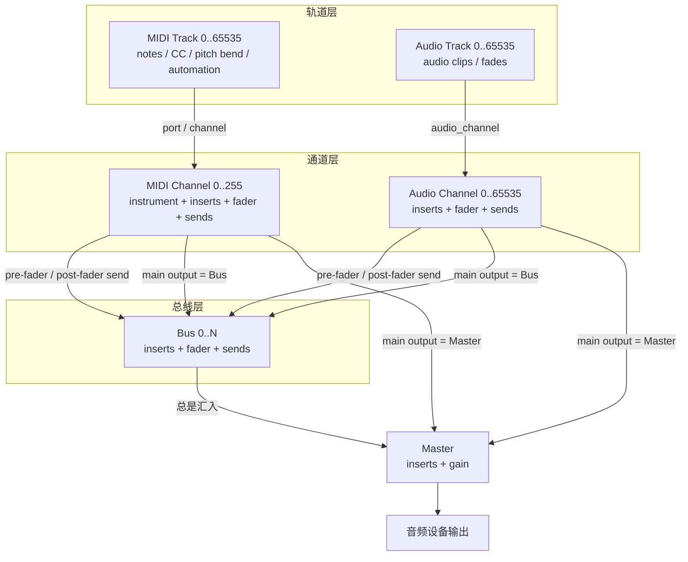
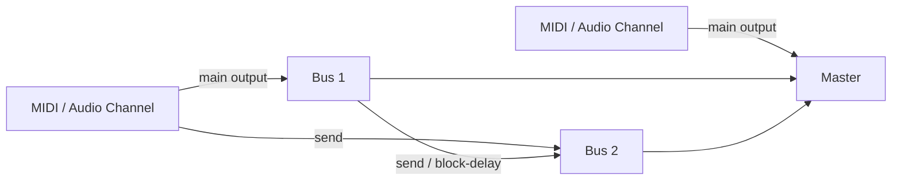
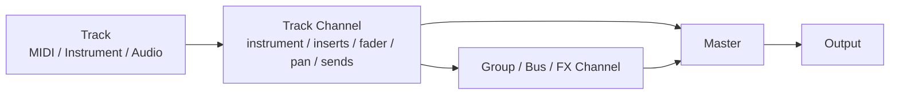
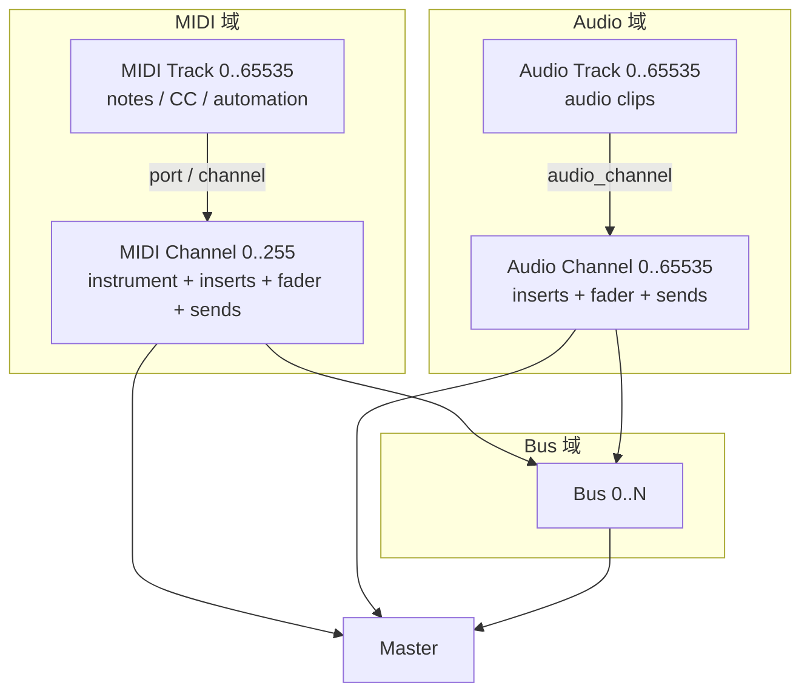
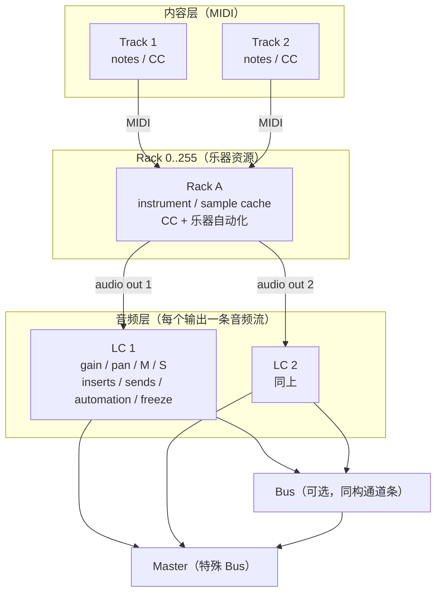

# 混音链路与通道模型

本文记录 yinhe 当前的混音信号流、通道数量上限、自动化归属，以及和成熟 DAW 的差异。
文中区分「当前实现」和「目标模型」，避免把设计意图和代码现状混在一起。

## 1. 术语

| 术语 | 含义 | 当前索引 |
|---|---|---|
| 轨道 Track | 内容容器：MIDI 音符 / 音频片段 / 自动化 | `u16`，0..65535 |
| MIDI 源通道 | MIDI 事件所属的端口 + 通道 | `port * 16 + channel`，0..255 |
| MIDI 混音通道 | MIDI 通道条：乐器 + insert + 推子 + 发送 | 0..255 |
| 音频通道 | 音频轨进入的混音条 | `u16`，0..65535 |
| Bus | 总线 / Return，可挂 insert、推子、发送 | `u16`，动态数量 |
| Master | 最终总输出，挂 master insert 和总增益 | 唯一 |

当前规则：MIDI 轨的混音通道恒等于它的端口/通道；音频轨的混音通道恒等于它的
`audio_channel`。轨道没有独立的混音通道路由字段。

## 2. 规模与索引

| 对象 | 上限 | 说明 |
|---|---:|---|
| 轨道 | 65536 | 音符里的 `track: u16`，GPU `MAX_TRACKS = 65536` |
| MIDI 源通道 | 256 | `u8`，`port << 4 \| channel` |
| MIDI 通道条 | 256 | `MixerParams.channels[0..256]` |
| 音频通道 | 65536 | `TrackData.audio_channel: Option<u16>` |
| Bus | 65536 | `u16`，实际数量由工程动态决定 |
| Master | 1 | 单独一条 |
| 默认乐器槽 | 256 | `channel_instruments[0..256]`，覆盖 A01..P16 |
| XSynth 参数 | 256 | `synth_params[256]` |
| 混音台 MIDI strip | 256 | 与 MIDI 源通道一一对应 |

## 3. 当前链路

### 3.1 总链路



关键点：

- 一条 MIDI 通道条可以被多条 MIDI 轨共享。共享后，乐器、insert、推子、声像、
  发送、主输出都共享。
- 一条音频通道条可以被多条音频轨共享。当前音频轨通过 `audio_channel` 指向音频条。
- 通道可以同时有：
  - 多条发送，分别去不同 Bus；
  - 一个主输出，去 Master 或某条 Bus。
- Bus 之间可以互相发送；Bus 自身最终总是汇入 Master。
- Bus 自发送和逆序发送使用上一块输出快照，形成块级延迟，避免代数环。

### 3.2 MIDI 事件到声音


MIDI 轨只提供事件；声音由 MIDI 通道条上的乐器产生。多条轨共享同一 MIDI 通道时，
它们共享同一个乐器实例。

### 3.3 音频片段到声音


音频通道条没有乐器，只有 insert、推子、声像和发送。

### 3.4 Bus 与 Master



当前实现中：

- channel → Bus 的主输出是「后推子」信号。
- send 有推子前 / 推子后两种。
- Bus 之间可以串联或互发；跨 Bus 的逆序发送和自发送有一块延迟。
- Bus 的输出没有单独的「去哪个 Master」选择，所有 Bus 最终都汇入唯一 Master。

### 3.5 自动化归属

| 自动化目标 | 存储位置 | 归属 |
|---|---|---|
| Tempo | `ConductorData.tempo` | 全局 |
| CC / Pitch Bend / RPN / NRPN | 轨道 `automation_lanes` | 轨道所属 MIDI 通道 |
| 内置 XSynth / 通道 DSP 参数 | 轨道 `automation_lanes` | `ParamDevice::ChannelInstrument` |
| 插件乐器参数 | 轨道 `automation_lanes` | `ParamDevice::PluginInstrument` |
| 总线增益 | Master 轨的 `automation_lanes` | `AutomationTarget::BusGain { bus }` |
| Master 音量 | 目前没有独立自动化 lane | 只有手动增益 |

## 4. 当前实现中的口径问题

### 4.1 BusGain 为什么是例外

`AutomationLane` 目前必须挂在一条轨道上，而 Bus 不是轨道。为了把总线增益自动化
放进工程时间线，代码把 `BusGain` lane 放在 Master 轨上。

于是出现了几处特判：

- `TrackKind::Master` 的 `TrackContent::Automation` 是否允许，需要为 BusGain 单独放行；
- `Document::add_automation_lane` / `sanitize` 要单独保留 Master 上的 BusGain lane；
- 删除 Bus 时要把 Master 上的 lane target 前移；
- AR 固定 Bus 行需要把 Master 上的 lane 显示到对应 Bus 子行。

这不是 Bus 本身的语义，而是「自动化必须挂在轨道上」这个模型限制造成的。
更彻底的方案是给自动化增加 owner：

```text
AutomationOwner = Track(track_idx) | Bus(bus) | Master | Conductor
```

或者把 Bus 自动化独立存到 Mixer 参数层。这样 `TrackContent` 不需要为 BusGain
开例外，AR 也能按 owner 直接渲染。

### 4.2 AudioModel 为什么曾回退到 MIDI Channel 0（已修复）

`AudioModel::from_model` 过去把非 MIDI 轨回退到 `global_channel()`：

```rust
t.midi_target_channel()
    .unwrap_or_else(|| t.global_channel())
```

音频轨、Folder、Master 轨的 `port/channel` 默认是 0，于是它们被当成 A01：
音频轨电平会读 A01 的混音表、音频轨上的 CC lane 会被当成 A01 的 bank 声明。

现在 `track_channels` 是 `Vec<Option<u8>>`，非 MIDI 轨为 `None`：
`track_channel()` 返回 `Option<u8>`，dispatch / 电平 / 鼓声明都显式跳过。
音频轨电平单独走音频通道表，不再复用 MIDI `track_channel`。

### 4.3 其他口径

| 项目 | 状态 |
|---|---|
| 默认乐器 | 已扩到 256（`channel_instruments`，A01..P16） |
| 鼓通道覆盖 | 已扩到 256（`channel_percussion`） |
| 音频通道下降级 | 已统一为 `audio_target_channel()` = `audio_channel.unwrap_or(0)` |
| 音频通道 UI | 模型是 `u16`，轨道属性下拉仍只到 0..31（待做） |
| 通道表示 | `InsertTarget` / `DockContext` 已收敛为 `MixerChannelId` 别名；`CaChannel` 是通道 AR 的视图子集，`ChannelNamespace` 是 dense 映射命名空间 |
| 混音操作 | `SetStrip` / `SetAudioStrip` / `SetBusStrip` / `SetMaster` 仍是四个入口（待收敛） |
| M/S | 轨道 `track_overrides` 的 M/S 与通道条 `StripParams.mute/solo` 仍是两套状态（语义已定，代码待统一入口） |
| 旧工程 | 已删除 `channel_routing`；旧工程里的该字段会被 serde 忽略，不再恢复 |
| 轨道电平表 | 非 MIDI 轨目前没有独立的 audio-track 电平路径 |

## 5. 成熟 DAW 的通用模型

大多数成熟 DAW 的核心不是「MIDI 通道条共享」，而是「每条轨道有自己的通道条」：



MIDI Channel 在这些 DAW 里通常只是事件路由（1..16），不是混音条的身份。
例如：

| DAW | 轨道与通道关系 | MIDI 通道的角色 |
|---|---|---|
| Studio One | 每条轨道有自己的 channel；Bus / FX channel 独立 | 乐器事件路由，不是混音条 |
| Cubase | MIDI / Instrument / Audio 轨 → Channel Strip → Group/FX → Stereo Out | MIDI 事件路由 |
| Ableton Live | 每条 Track 就是一个 channel；Group Track 做总线 | MIDI 通道是 clip/事件路由 |
| Bitwig | 每条 Track 是 channel；Group/FX/Return 做总线 | MIDI 通道是事件路由 |
| FL Studio | Channel Rack 乐器 → Mixer Track → Master | MIDI 通道是模式/事件路由 |
| REAPER | 每条 Track 是 channel；Folder 可充当 Bus | MIDI 通道是事件路由 |

共同点：

- 轨道级有独立的音量、声像、insert、send；
- Bus / Group 是汇总层；
- Master 是最终层；
- 侧链、VCA、Solo 模式、自动化都是围绕这个层级做的。

## 6. 目标模型

### 6.1 目标 A：共享 MIDI 通道条（当前实现）

按「Master >（256 MIDI 通道 > 65536 MIDI 轨道）+ 65536 音频通道」的目标，
当前实现可以形式化为：



建议把它作为明确的产品约束：

1. **MIDI 轨是内容层，MIDI 通道是共享混音层。**
   多条 MIDI 轨可以共享一条 MIDI 通道；共享后音色、insert、推子、声像、发送都共享。
2. **音频轨是内容层，音频通道是共享混音层。**
   当前新建/自动分配保持 1 轨 : 1 音频通道；数据模型仍允许以后多条音频轨共享一条通道。
   以后要改的只是分配策略和 UI，不需要改数据模型。
3. **Bus 只做汇总，不承载轨道内容。**
4. **Master 唯一，只有总 insert 和总增益。**
5. **文件夹不是 Bus。** 文件夹只做组织，不参与混音。
6. **轨道不另设混音通道路由字段。**
   MIDI 轨的通道就是 `port/channel`，音频轨的通道就是 `audio_channel`。
7. **目标 A 下不添加每轨完整 channel strip。**
   共享通道 / RACK 是核心卖点。需要独立混音时，用不同的 MIDI 通道
   （或 VCA / 不同音频通道）解决；目标 B 增加完整 LC，但 LC 的粒度是
   Rack 的一条音频输出，不是无条件给每条轨复制 strip。

这个模型和成熟 DAW 的差别不是对错，而是取舍：牺牲每条轨道的独立推子，换来 65536 轨
规模下不会创建 65536 条完整 channel strip。对黑乐谱这种轨道数量巨大、但混音结构
相对固定的工程，这个取舍是合理的。

### 6.2 目标 B：Rack + 完整音频通道（LC）

#### 6.2.1 先看两条方向：MIDI 和音频不是同一条线



图里 Rack 在 LC 前面，是因为**音频信号流**是 Rack（乐器产生声音）→ LC（音频
通道处理）→ Bus → Master。MIDI 方向是 Track → Rack，LC 不在 MIDI 路径上。

可以把 LC 理解成「这条音频流的现代 DAW 轨道通道条」，但它的输入是 Rack 的一条
音频输出，不是 Track 的 MIDI。Track 只是内容的来源。

#### 6.2.2 定论：LC 的粒度是音频流，不是 Track

LC 不属于 Track，而属于**一条音频流**。Track 通过 Rack 间接决定自己走哪条 LC：

| Rack 类型 | 音频输出 | LC 粒度 | 能否每轨独立 |
|---|---|---|---|
| 内置音源，per-track 输出 | N 条 | 每条 Track 一条 LC | 能 |
| 多输出插件，已激活 | N 条 | 每条输出一条 LC | 同一输出内的轨共享 |
| 单输出插件 | 1 条 | 整个 Rack 一条 LC | 不能 |
| 音频轨 / 音频通道 | 1 条 | 每个音频通道一条 LC | 按音频通道独立 |

因此数据模型不要写死 `Track.lc = 1:1`，而是：

```text
Track.rack -> Rack
Rack.output[i] -> LogicalChannelId
Track.audio_source -> LogicalChannelId   // 音频轨
```

同一个 Rack 的单输出被 6 条轨使用时，6 条轨共享 1 条 LC。UI 必须显示
「这个 LC 由 6 条轨共享」，不能假装每轨都有独立推子。

#### 6.2.3 LC 做完整的现代 DAW 通道条

LC 可以拥有：

- gain / pan / mute / solo；
- insert 链（默认空，按需添加）；
- pre-fader / post-fader sends；
- 主输出到 Bus 或 Master；
- 音频自动化：MixerGain / MixerPan / Send 量 / insert 参数；
- freeze（按这条音频流冻结）；
- 以后可加侧链输入。

不把 LC 做成 65536 条常驻完整 strip：只给活跃音频流分配，insert 链为空时只跑
gain/pan。700 轨共享 16 个 Rack 时只有 16 条 LC，开销很小；只有内置音源做
per-track 输出时才会出现 700 条 LC，但空链仍然很轻。

#### 6.2.4 Rack 只做乐器资源

Rack 保留：

- 乐器（内置音源或插件链）；
- 样本 / 预设缓存；
- 乐器参数自动化；
- CC 的接收与执行；
- 输出拓扑（单输出 / 多输出 / per-track）。

Rack **不设推子、不设 insert 链、不设独立 M/S**。原因：

- 推子和 insert 属于音频通道；放在 Rack 会与 LC 重复；
- 单输出 Rack 的 LC 就是整个 Rack 的输出通道，LC 上的推子/insert 等价于
  「Rack 推子/insert」；
- 多输出 Rack 若需要共同效果，用一个 Bus 汇总，而不是给 Rack 再加一套 insert；
- Rack 级 M/S 可以作为 UI 批量操作（同时切换所属 LC），但不做成独立音频节点。
  第一版不建议存 Rack M/S 状态，避免又多一层「最终可听」判断。

#### 6.2.5 自动化归属：按域分工，不重复

| 层 | 存储 | 自动化目标 | 能否导出 MIDI |
|---|---|---|---|
| Track | `track.automation_lanes` | 音符级力度/长度/音高、MIDI CC / PB / RPN / NRPN | 能 |
| Rack | `rack.automation` | 乐器参数、CC、插件参数 | 仅能映射到 CC 的部分 |
| LC | `lc.automation` | MixerGain / MixerPan / Send / insert 参数 | 不能 |
| Bus / Master | `bus.automation` / `master.automation` | 同 LC | 不能 |

关键点是 **CC 的双重身份**：

- **存储归属是 Track**：CC 是 MIDI 事件，必须留在轨道事件流里，才能编辑、
  复制、撤销和导出 MIDI；
- **执行归属是 Rack**：CC 最终改变的是乐器状态；
- 共享 Rack 时，CC 是共享通道状态。多条轨同时写 CC7 会互相覆盖，这是共享
  乐器的固有限制，不是宿主能拆开的；
- 如果用户要每轨独立 CC，只能给该轨独立 Rack 实例，或使用支持 per-note
  expression / 多声部的插件。

所以「可导出的 MIDI CC 全都还给 Rack」这个说法要修正为：

```text
CC 存在 Track，执行在 Rack，导出从 Track 写回 MIDI。
```

Rack 自己的乐器参数自动化，只有能映射成 CC 的部分才导出；第三方插件参数
自动化不导出 MIDI。

CC7/11 和 LC gain 不是同一个东西：

| 目标 | 作用点 | 用途 |
|---|---|---|
| CC7 / CC11 | 乐器内部 | MIDI 音量 / 表情，可导出 |
| LC gain | 乐器输出之后 | 混音推子，不导出 MIDI |

两者串联，不冲突。不要把 LC gain 搬到 Rack，也不要把 CC 自动化搬到 LC。

#### 6.2.6 Bus 和 Master 怎么办

Bus 和 LC 本质上是**同一种音频通道条**，只是输入不同：

- LC 的输入是 Rack 的一条音频输出；
- Bus 的输入是多条 LC / Bus 的求和；
- Master 是特殊 Bus：有 insert 和总增益，没有输出和 send。

数据模型/DSP 层统一成一个 `MixerNode`：

```rust
struct MixerNode {
    id: MixerNodeId,          // LC / Bus / Master 的稳定身份
    kind: MixerNodeKind,      // LogicalChannel | Bus | Master
    strip: StripParams,       // gain / pan / mute / solo
    inserts: Vec<InsertRef>,
    sends: Vec<SendParams>,
    output: OutputTarget,     // Bus(id) | Master
    automation: Vec<AutomationLane>,
    freeze: Option<FrozenAudio>,
}
```

这样不会出现「LC 一套、Bus 另一套」的重复实现。Bus 可以有完整 insert、推子、
发送和自动化；LC 可以直接进 Master，也可以先进 Bus。Bus 可以嵌套，但要有
反馈检测。Bus 用稳定的 `BusId`，自动化 owner 是 `Bus(BusId)`，不再把 BusGain
塞进 Master 轨。

VCA 仍是独立的控制组，不是 Bus，也不产生音频通路，以后再加。

#### 6.2.7 单输出插件时会发生什么

单输出插件只有一个音频输出，所以只能有一条 LC：

```text
Track 1 ─┐
Track 2 ─┼─→ Rack Serum（1 条输出）─→ LC 1（共享）
Track 3 ─┘
```

此时：

- LC 的 gain / insert / automation 影响全部 3 条轨；
- LC 的 mute / solo 是整组音频门；
- LC 的 freeze 冻结整个 Rack 输出；
- Track M/S 仍然是内容门：它只能停止该轨后续 MIDI，不能把已经混进
  Rack 输出的那部分音频抽走；
- UI 必须显示「LC 1 · 由 3 条轨共享」，冻结/静音按钮要提示作用范围。

要让这 3 条轨完全独立，只能：

1. 给每条轨独立 Rack 实例（失去共享内存/CPU 优势）；
2. 换支持多输出/多声部的插件；
3. 接受离线 stem（不实时，且不保证与实时完全一致）。

这三条都不是默认路径。

#### 6.2.8 旧工程迁移

旧工程保持现有听感：

1. 旧 MIDI 通道 `i` → Rack `i`；
2. 旧通道条 `i` 的 gain/pan/M/S/insert/send/output → LC `i`；
   因为旧模型是单输出、共享通道，所以这个 LC 由该通道的所有轨共享；
3. 旧 `channel_instruments` → Rack 的默认乐器；
4. 旧 `synth_params` → Rack 的乐器参数；
5. 旧音频通道 `j` → 音频轨的 LC `j`；
6. 旧 Bus → 带稳定 `BusId` 的 Bus；
7. 旧 `BusGain` lane → `AutomationOwner::Bus(BusId)`。

迁移后行为与现在一致：多条 MIDI 轨共享同一 MIDI 通道，就共享同一条 LC。
以后给内置音源开 per-track 输出时，用户可以显式拆分，而不是迁移时自动拆。

#### 6.2.9 代价与边界

- 对象更多，但 LC / Bus / Master 共用同一套 strip 实现，不是三套代码；
- 引擎要支持稀疏 LC 和 Rack 输出拓扑检测；
- 外部插件要有单输出/多输出能力表；
- 工程保存、undo、迁移都要按稳定 ID 处理；
- UI 必须诚实显示「这个 LC 由几条轨共享」；
- 不做：Rack 推子/insert、单输出插件的每轨 LC、65536 条常驻 strip。

### 6.3 当前实现与目标 B 的差距

当前代码是目标 A：MIDI 通道条就是共享混音层。目标 B 需要新增：

1. `RackId`（0..255）与 Track 的关联；
2. `LogicalChannelId` 与 Rack 输出拓扑（单输出 / 多输出 / per-track）；
3. `BusId` 稳定身份；
4. 统一的 `MixerNode`（LC / Bus / Master 共用 strip、insert、send、automation）；
5. 引擎支持 Rack 的 per-track 输出（内置音源优先）；
6. 外部插件能力表：单输出 / 多输出 / 多声部；
7. 混音图的稀疏 LC 分配与懒分配；
8. LC 的完整通道条：gain / pan / M / S / inserts / sends / automation / freeze；
9. 旧工程迁移：旧 MIDI 通道 → Rack，旧通道条参数复制到共享 LC。

## 7. 与成熟 DAW 的差距

| 能力 | 当前 | 成熟 DAW | 建议 |
|---|---|---|---|
| 每轨独立推子/声像 | 无，MIDI 轨共享通道 | 有 | 目标 B：LC 完整 strip；单输出插件时 LC 由多轨共享 |
| 每轨独立 insert | 无，共享通道 | 有 | 目标 B：insert 在 LC；单输出插件时共享 LC 的 insert |
| 每轨独立乐器 | 无，共享 MIDI 通道乐器 | 有 | 保持通道级；需要独立音色时用不同 MIDI 通道 / Rack |
| Bus / Group | 有 | 有 | 保持；目标 B 与 LC 共用 MixerNode |
| VCA | 无 | Cubase/Studio One 有 | 可后加；控制通道组，不产生音频通路 |
| 侧链 | 无 | 多数有 | 可后加；先做内置压缩器侧链，再考虑插件 |
| 发送前/后 | 有 | 有 | 保持 |
| Bus 自动化 | BusGain（挂在 Master） | 原生 Bus 自动化 | 改成 `AutomationOwner::Bus(BusId)` |
| 音频通道音量自动化 | 无 | 有 | 增加 `MixerGain { LC(id) }` lane |
| Master 音量自动化 | 无 | 有 | 增加 `MixerGain { Master }` lane |
| Track M/S | `track_overrides` | 有 | 保留内容级 M/S |
| 通道 M/S | `StripParams` | 有 | 保留混音级 M/S；目标 B 落在 LC |
| 延迟补偿 | 有 | 有 | 保持 |
| 轨道冻结 | 无 | 多数有 | 目标 A 做通道冻结；目标 B 按 LC（音频流）冻结 |
| 多硬件输出 | 无 | 有 | 需要时再加 |
| 环绕声 | 无 | 部分有 | 暂不考虑 |

## 8. 关键概念与实现建议

### 8.1 VCA 是什么

VCA（Voltage Controlled Amplifier）是「控制电压放大器」的缩写。在 DAW 里它不是
音频总线，而是一个**控制组**：

- 不接收音频输入；
- 不做音频求和；
- 不挂 insert；
- 只提供一个增益，按成员列表去乘多个通道/Bus 的推子。

```text
VCA "Drums" gain = -6 dB
├─ MIDI Channel A10
├─ MIDI Channel B10
└─ Bus 3
```

效果类似「同时拖动这几个通道的推子」，但不会改变它们的路由、发送和 insert。

它适合当前模型，因为：

- 不增加每轨推子；
- 一个 VCA 可以控制多条 MIDI 通道 / Bus；
- 与共享通道 / RACK 的卖点不冲突。

以后如果要做，模型可以是：

```rust
struct VcaGroup {
    id: VcaId,
    name: String,
    gain: f32,
    members: Vec<MixerChannelId>,
}
```

混音图在计算成员通道时先乘 VCA gain，再走原来的推子 / 发送 / 主输出。

### 8.2 Bus 侧链是什么

侧链（sidechain）是「用 A 的信号去控制 B 上的处理器」，A 不直接进入 B 的音频
通路。典型用法：

- 底鼓触发贝斯 Bus 上的压缩器；
- 人声触发音乐 Bus 上的压缩器；
- 一个 Bus 触发另一个 Bus 上的 Gate。

它和 Send 的区别：

- Send 是把音频送到目标 Bus 参与求和；
- Sidechain 只把音频作为检测信号，不参与求和。

当前 insert 处理器只有主输入，没有侧链输入，所以要做侧链需要：

1. 在 `MixerGraph` 里为每个 insert 增加一个 sidechain 缓冲；
2. 在 `MixerParams` 里增加 `SidechainSource { channel: MixerChannelId }`；
3. 先支持内置压缩器 / Gate，再考虑 VST3/CLAP 的 sidechain 端口。

这是 P2 功能，不影响当前链路正确性。

### 8.3 Bus 自动化如何做成原生

当前实现的问题不是「Bus 不能自动化」，而是 Bus 没有自己的自动化宿主，只能把
`BusGain` lane 塞进 Master 轨。

原生做法建议分两步：

1. **稳定 BusId**
   当前 Bus 用 `Vec` 下标标识，删除 Bus 时后续索引前移，所有 lane target 都要
   手工重映射。应给 Bus 增加稳定 ID：

   ```rust
   struct Bus {
       id: BusId,          // 稳定，不随删除/重排变化
       strip: StripParams,
       inserts: Vec<InsertRef>,
       sends: Vec<SendParams>,
       automation: Vec<AutomationLane>,
   }
   ```

   `MixerChannelId::Bus(BusId)` 和 `AutomationTarget` 都用这个 ID。
   目标 B 下 Bus 与 LC 共用同一套 `MixerNode`，这里只是 Bus 的字段视图。

2. **自动化 owner**
   把自动化从「必须挂在轨道」改成「按 owner 存储」：

   ```text
   AutomationOwner = Track(track) | MixerChannel(MixerChannelId) | Conductor
   ```

   Bus 的 lane 直接属于 `MixerChannel(Bus(id))`，不再借住 Master。AR 的固定 Bus
   行直接读对应 owner 的 lane。

这样 `TrackContent` 不需要为 BusGain 开特例，删除 Bus 时也不会出现「模型删了，
Master 上的 lane 还没删」的错位。

### 8.4 音频通道与 Master 的音量自动化

建议统一成一个通用的混音参数目标，而不是继续给每种通道加一个专用变体：

```rust
enum AutomationTarget {
    // 现有 MIDI 原生目标
    CC { controller: u8 },
    PitchBend,
    Rpn { parameter: u16 },
    Nrpn { parameter: u16 },

    // 混音台参数
    MixerGain { channel: MixerChannelId },
    MixerPan { channel: MixerChannelId },

    // 全局
    Tempo,
}
```

其中：

- 目标 A：`MixerGain { Midi(ch) }` = MIDI 通道推子；`Audio(ch)` = 音频通道推子；
- 目标 B：推子属于 LC，统一写成 `MixerGain { LogicalChannel(id) }`；
- `MixerGain { Bus(id) }` = Bus 推子自动化；
- `MixerGain { Master }` = Master 推子自动化；
- `MixerPan { .. }` 同理。

`MixerChannelId` 会随目标 B 演进：

```text
目标 A: Midi(u8) | Audio(u16) | Bus(u16) | Master
目标 B: LogicalChannel(LogicalChannelId) | Bus(BusId) | Master
```

Rack 不是混音节点，不进入 `MixerChannelId`；它只提供音频输出。

要区分两种「音量」：

| 目标 | 作用点 | 用途 |
|---|---|---|
| `CC { controller: 7 }` | MIDI 事件进入乐器之前 | MIDI 音量、乐器表情 |
| `MixerGain` | 通道条 insert 之后、推子处 | 混音推子自动化 |

现在右键音量旋钮添加的是 CC7 / BusGain，这个口径应该逐步改成：
MIDI 通道推子自动化走 `MixerGain`，CC7 作为显式的 MIDI CC 目标保留。

自动化求值可以直接复用 BusGain 的 tick 求值路径：每个块开始时根据当前 tick
把 lane 值写到对应通道的 `StripParams.gain` / `.pan`。手动推子和自动化的关系
需要明确为「有 lane 时以 lane 为准」或后续再实现 Read/Write/Latch 模式。

### 8.5 Track M/S 与 Channel M/S 如何统一

不建议把两者合并成一份状态，因为它们回答的是两个不同问题：

| 层 | 位置 | 作用 |
|---|---|---|
| Track M/S | AR 轨道面板 | 控制该轨的内容是否送入通道；不影响同通道其他轨 |
| Channel M/S | MIX 通道条 / 通道 AR 通道行 | 控制整条通道输出；影响共享该通道的所有轨 |

建议保留两层，但把语义写死：

```text
轨道可听 = 轨道 mute/solo 通过
通道可听 = 通道 strip mute/solo 通过
最终可听 = 轨道可听 && 通道可听
```

Solo 语义：

1. 有轨道 solo 时，只允许 soloed 轨道通过；
2. 有通道 solo 时，只允许 soloed 通道通过；
3. 两者同时存在时，取交集；
4. 没有 solo 时，mute 正常生效。

UI 上必须区分名字和提示：

- AR 轨道面板：轨道静音 / 轨道独奏；
- MIX strip 和通道 AR 通道行：通道静音 / 通道独奏。

这样既保留「多轨共享通道」下单独屏蔽某条轨的能力，也保留整条通道静音的能力。
不需要把 `TrackOverride` 和 `StripParams` 合成一个结构，只需要统一「最终可听」
的计算入口，避免两套 solo 逻辑各算各的。

到了目标 B，层次会变成：

| 层 | 作用 |
|---|---|
| Track M/S | 内容门：该轨音符/音频是否送入 Rack |
| Logical Channel M/S | 音频门：这条音频流是否输出 |
| Rack M/S | 不做独立状态；需要整组静音时由 UI 批量切换所属 LC，或走 Bus |

Track M/S 仍然是内容门，Logical Channel M/S 才是真正的“这条音频流是否输出”。
per-track 输出的 Rack 下，两者恰好对应单轨；单输出插件下，LC M/S 作用于整组。

需要明确：**Track M/S 是内容门，不是音频门。**

- Track Mute 只能阻止该轨后续音符/音频送入通道；
- 已经发声的音符需要按轨发 note-off / All Sound Off，释放尾音；
- 它不能把共享插件乐器已经混在输出里的那部分音频“抽走”；
- 真正的音频级独立需要独立的轨道音频流，见 8.7。

### 8.6 轨道冻结怎么设计

因为共享通道/RACK 是核心，**冻结的基本单位应该是 MIDI 通道，而不是单条轨道**。

原因：

- 同一 MIDI 通道上的多条轨共享乐器、insert、推子；
- 单独冻结一条轨，无法在不复制乐器/insert 的情况下得到与实时播放完全一致的结果；
- 如果给每条轨复制乐器，就违背了共享 RACK 的设计。

目标 A 推荐第一版：

```text
冻结 MIDI 通道：
  离线渲染 该通道所有轨道的乐器输出
  得到一条 frozen audio
  播放时跳过该通道的 MIDI 分发，直接播放 frozen audio
  通道 insert / 推子 / 声像 / 发送 仍然实时生效
```

目标 B 下升级为**按 Logical Channel 冻结**（LC = 一条音频流）：

```text
冻结 Logical Channel：
  离线渲染该 LC 的音频流
  播放时跳过这条流的实时输出，直接播放 frozen audio
  Logical Channel 的 gain / M / S / sends 仍然实时生效
```

per-track 输出的 Rack（内置音源）冻结的是单轨；多输出插件冻结的是该输出组；
单输出插件冻结的是整个 Rack。前提是 Rack 能按输出拆分，单输出插件只能退回
Rack/通道冻结。

这样：

- 冻结后仍可调通道推子、insert、发送；
- 修改该通道任何轨道的音符、乐器、通道 insert 时，冻结自动失效；
- 撤销/重做需要记录冻结状态和源 revision；
- 工程需要保存 frozen audio 资产，或保存到工程缓存目录。

UI 上可以仍然让用户在轨道上点「冻结」，但提示/状态显示为「冻结通道 A01」，
并明确同通道其他轨也会一起冻结。

如果以后确实需要「单轨冻结」，目标 B 的 Logical Channel 是正确方向；外部单输出
插件仍只能做离线 stem，无法保证与实时共享 Rack 完全一致。

### 8.7 同一乐器的音频流能否按轨道拆分

直接回答：**实时、通用、对任意插件都成立的分轨，不切实际。**

原因不是实现懒，而是音频图的结构：

```text
Track A ─┐
Track B ─┼─→ 同一个插件乐器实例 ─→ 一条立体声输出
Track C ─┘
```

主机能控制送到插件的 MIDI，但插件内部把这些音符合成成一条音频后，主机拿不到
“哪一部分属于 Track A”。插件如果支持多输出，可以把不同 part 分到不同输出；
这是插件能力，不是宿主通用能力。

分场景看：

| 方案 | 实时 | 对任意插件 | 与共享 RACK 兼容 | 结论 |
|---|---|---|---|---|
| 实时按轨拆分插件输出 | 否 | 否 | 是（但做不到） | 不现实 |
| 插件多输出分轨 | 是 | 否，依赖插件 | 是 | 可选，按插件支持 |
| 内置 yinhe-synth 按轨分 buffer | 是 | 是（仅内置） | 部分 | 可行；每轨得到独立 LC，但仍有共享调制/voice stealing |
| 离线按轨渲染 stem | 否 | 是 | 是 | 可用于冻结/导出，不等于实时独立 |
| LC 冻结（按音频流） | 是（播放） | 是 | 是 | 推荐 |

内置 XSynth / yinhe-synth 有一个优势：每个 voice 知道自己的 note/track。理论上
可以：

- 每个轨道一个立体声 buffer，对应一条 LC；
- 渲染时按 track 写入不同 buffer；
- 每条 LC 有自己的 gain/pan/insert/send。

但它仍不是“完全独立”：

- 乐器级 LFO、全局调制、voice stealing 是共享状态；
- 多轨独立渲染再相加，只有在乐器严格线性时才等于原始输出；
- 每条活跃轨都开 buffer，65536 轨时内存和缓存压力不可接受。

所以如果目标是**冻结**，按 LC 冻结是正确粒度；如果目标是**导出分轨**，可以做离线
按轨渲染，但要接受“与实时插件输出可能有差异”。

如果确实需要某条轨完全独立，唯一干净的方案是给该轨独立的 Rack 实例
（opt-in），这会失去共享 RACK 的内存和 CPU 优势，不适合作为默认。

### 8.8 常见插件的输出能力与 Studio One 的处理

先区分两个概念：

- **多声部（multitimbral）**：一个插件实例可以接收多个 MIDI 通道，每个通道不同音色；
- **多输出（multi-output）**：一个插件实例可以向宿主输出多条音频。

多声部不等于多输出。比如 Xpand!2 可以多声部，但只有一个立体声输出；Omnisphere
既多声部又多输出。

#### 常见多输出插件

以插件当前版本和宿主封装为准，常见的有：

| 类型 | 例子 |
|---|---|
| 采样器 | Kontakt（手动添加输出）、HALion、Falcon、SampleTank、MachFive |
| 鼓机/鼓采样 | Addictive Drums 2、EZdrummer 3、Superior Drummer 3、Steven Slate Drums 5、BFD3、Groove Agent 5、Battery 4、Maschine |
| 多声部合成器 | Omnisphere、Trilian、Keyscape、Avenger、Reaktor（取决于 ensemble） |
| 宿主内置 | Studio One Impact XT（打击垫可分配多输出） |

Kontakt 是典型：默认只有主输出，需要在插件 Outputs 页面添加立体声/单声道输出，
宿主才会看到更多 bus。

#### 常见单输出插件

大多数“一个音色”的合成器和钢琴：

- Serum、Vital、Sylenth1、Diva、Hive 2、Massive、Pigments、Phase Plant；
- Addictive Keys、Pianoteq、Lounge Lizard；
- Analog Lab（多声部但常见为单立体声输出）；
- Xpand!2（多声部、单立体声输出）。

这些插件在宿主里只有一条 stereo output。要独立处理多个音色，只能：

1. 开多个插件实例；
2. 用插件的多输出版本（如果有）；
3. 接受它们共享一条通道。

#### Studio One 怎么处理 Multi Instrument

Studio One 的 Multi Instrument 是一个容器，可以放多个虚拟乐器、做 layer/split。
它默认把容器内所有乐器**求和到一条主输出通道**。

展开后可以看到每个乐器自己的子通道：

```text
Multi Instrument 主通道
├─ Instrument A 子通道
├─ Instrument B 子通道
└─ Instrument C 子通道
```

操作方式：

- 点击主通道推子下方的文件夹图标（show subchannels），展开子通道；
- 在 Multi Instrument 编辑器里选中某个乐器，左侧通道条的 Output 可以选择
  Bus / FX / 物理输出；
- 这样每个**乐器**可以独立走自己的通道，即使它是单输出插件。

但注意：

- 如果多个 Track 同时喂同一个单输出乐器，它们仍然共享这一个子通道，
  因为插件内部已经把声音混成一条；
- Studio One 不会按 Track 拆一个单输出插件的音频；
- 对多输出插件，需要先在 Instrument Rack 里启用输出，子通道才会出现；
- 在 Multi Instrument 内部再放多输出乐器，能看到的输出可能受容器限制，
  官方论坛也有“先启用多输出再放进 Multi Instrument”的经验。

这正好验证了目标 B 的边界：

- **Logical Channel 的粒度应该是 Rack 的一条音频输出，而不是无条件按 Track。**
- 单输出插件：一个 Rack = 一条 Logical Channel；
- 多输出插件：一个 Rack = N 条 Logical Channel；
- 内置音源：如果实现 per-track voice split，一个 Rack 可以按 Track 输出 N 条 Logical Channel。

### 8.9 实时检测插件是单输出还是多输出

可以检测，但“实时”应该理解为：**插件实例化后、输出拓扑变化时检测**，
而不是每个音频块都去问一次。

不同插件格式的查询入口：

| 格式 | 查询方式 |
|---|---|
| VST3 | `IComponent::getBusCount(kAudio, kOutput)` + `getBusInfo` / `IAudioProcessor::getBusArrangement`；部分插件需要先激活 bus |
| CLAP | `clap_plugin_audio_ports` 的 `count(is_input=false)` / `get(index)`；插件可通过 `rescan` 通知宿主刷新 |
| AU / AUv3 | 输出 scope 的 `kAudioUnitProperty_ElementCount`，或 `AUAudioUnit.outputBusses` |
| VST2 | `numOutputs` |

能拿到：

- 输出 bus 数量；
- 每个 bus 的声道数；
- bus 名称（部分插件提供）；
- 当前激活/未激活状态。

拿不到：

- 哪条 Track 的声音去了哪个输出；
- 一个输出里混了哪些 Track；
- 插件内部 pad/part 到输出的映射。

所以宿主只能知道 **Rack 有几个输出**，不能自动知道 **每条轨是否有独立音频**。
Track → Output 的映射需要用户显式指定，或者由插件自己的 pad/part 设置决定。

建议的数据结构：

```rust
struct RackOutputTopology {
    outputs: Vec<RackOutput>,
    dynamic: bool, // 插件是否可能通过 rescan 改变输出数量
}

struct RackOutput {
    name: String,
    channels: u16,
    active: bool,
}
```

UI 可以据此给出明确提示：

- 单输出：`1 个输出 · 冻结/静音影响本 Rack 的 6 条轨道`；
- 多输出：`8 个输出 · 当前轨 → Out 3 · 该输出还有 2 条轨`；
- 输出未激活：`插件支持多输出，当前只启用了 1 个`；
- 拓扑变化：显示“插件输出已变化，需要重建 Rack”，不要静默错位。

检测时机：

1. 插件实例化后查询一次；
2. 用户激活/取消输出后查询；
3. 插件发出 `rescan` / `IoChanged` 时查询；
4. 拓扑变化时重建该 Rack 的 Logical Channel 路由，冻结状态失效。

不要每帧轮询，也不要根据插件名字猜能力。单输出插件就是单输出，多输出插件未激活
输出时也应当按当前激活输出数处理。

### 8.10 没有 MIDI 通道概念的 DAW 如何导出 MIDI

先明确 SMF 的结构：

- SMF Type 1 可以有很多 **track chunk**；
- 每个 MIDI 事件仍然只有 4 bit 的 **channel**，也就是 16 个通道；
- **track chunk 不等于 MIDI channel**。

所以“没有 MIDI 通道概念”的 DAW，导出时有几种常见策略：

| 策略 | 结果 | 问题 |
|---|---|---|
| 每个 DAW 轨一个 track chunk，全部 channel 1 | 轨数可以超过 16 | 通道信息丢失；导入到别的 DAW 可能被合并 |
| 顺序分配 channel 1..16 | 16 轨以内清晰 | 超过 16 轨必须复用通道 |
| 复用 1..16，多出的轨继续用相同通道 | 轨数不受限 | 多个轨共用通道，音色/CC 可能冲突 |
| 多 port：SMF port meta event 或拆成多个文件 | 可超过 16 通道 | port meta 不是所有播放器都支持 |

实际例子：

- **Ableton Live**：只导出单个 MIDI clip 的 SMF0，所有事件在 channel 1；
  多轨要逐条 consolidate/export，没有一个“按工程导出多轨 MIDI”的入口。
- **Reason**：内部不依赖 MIDI channel，导出通常全部落在 channel 1。
- **Studio One**：导出 SMF Type 1，按轨道组织 track chunk；MIDI 数据只在轨道级别
  channelize，最多 16 个 channel。超过 16 条需要共用通道或拆分多份文件；
  VST3 多 port 能力不等于 SMF 一定能保留 port。
- **Logic**：保留事件的 MIDI channel，必要时可以按 channel 拆分 region。
- **Cubase**：有多 port MIDI 体系，但标准 SMF 仍受每 port 16 channel 的限制，
  工程超过 16 个独立通道时需要多文件或 port meta。

因此“多于 16 条”本身不是问题，**多于 16 个同时需要独立音色的 MIDI 通道**才是问题。
Track chunk 可以无限多，但 channel 只有 16 个。

当前 yinhe 的导出实现在 `crates/yinhe-midi/src/writer.rs`：

```rust
let ch = u4::new(track.channel & 0x0F);
```

这意味着：

- 每条轨道写成独立 track chunk；
- 但 `port` 被忽略，channel 被截到 0..15；
- 256 通道工程导出后，B01..P16 会和 A01..A16 落在相同 channel 上；
- 导入到别的 DAW 时可能出现音色/CC 串台。

建议后续把导出策略做成显式选项：

1. **单文件 + port meta event**：用 0x21 port meta 标记每个轨道所属 port；
2. **按 port 拆分多个 MIDI 文件**：`song.port-A.mid`、`song.port-B.mid`；
3. **压缩到 16 通道**：明确警告会合并哪些通道；
4. 默认不要静默丢掉 `port`。

## 9. 推荐的清理顺序

### P0：先消灭行为不一致

1. `channel_instruments` / `channel_percussion` 扩到 256，或明确限制 16 并隐藏 B..P。
   推荐扩到 256。
2. `AudioModel.track_channels` 改为 `Vec<Option<u8>>`，非 MIDI 轨直接跳过。
3. `audio_target_channel()` 统一回退 `audio_channel.unwrap_or(0)`。
4. 收敛 `MixerChannelId` / `InsertTarget` / `DockContext` / `CaChannel`。
5. BusGain 改成 `AutomationOwner::Bus`，或者至少在能力模型里显式声明 Master 允许 BusGain。

### P1：补齐核心能力

1. **通道冻结**（按共享通道模型，先做 MIDI 通道冻结）。
2. `MixerGain` / `MixerPan` 自动化，覆盖 MIDI / 音频 / Bus / Master。
3. Bus 自动化 owner + 稳定 BusId。
4. **M/S 语义统一**：保留 Track M/S 与 Channel M/S 两层，但共用最终可听计算。
5. Rack 输出拓扑检测与单输出/多输出提示。
6. VCA 控制组。

### P2：大工程能力

1. Bus 侧链（先内置压缩器）。
2. MIDI 导出保留 port：port meta 或多文件拆分。
3. 多硬件输出。
4. 乐器多输出。
5. 更完整的 Solo 模式（Solo-safe、Solo by Bus）。

### P3：目标 B 重构

1. 数据模型拆成 `Rack` + 统一 `MixerNode`（LC / Bus / Master）；
2. 旧工程迁移：旧 MIDI 通道 → Rack，旧通道条参数复制到共享 LC；
3. 内置音源支持 per-track voice/output buffer；
4. 外部插件能力表：单输出 / 多输出 / 多声部；
5. 混音图支持稀疏 LC 与懒分配；
6. LC 完整通道条：gain / pan / M / S / inserts / sends / automation / freeze；
7. Bus 稳定 `BusId` 与 `AutomationOwner::Bus`；
8. Rack 乐器参数自动化与样本缓存共享；
9. 单输出插件的共享 LC 提示与冻结/静音作用范围。

## 10. 相关代码

- `crates/yinhe-core/src/model.rs`：`TrackData`、`mixer_channel`、`channel_instruments`
- `crates/yinhe-mixer/src/params.rs`：`MixerParams`、Bus、发送、主输出
- `crates/yinhe-mixer/src/graph.rs`：通道 / Bus / Master 的实际 DSP 链路
- `crates/yinhe-audio/src/channel_layout.rs`：MIDI / 音频通道的 dense 映射
- `crates/yinhe-audio/src/engine_mixer.rs`：持久化参数 ↔ 混音图接线
- `crates/yinhe-audio/src/audio_model.rs`：MIDI 事件、鼓声明、音频模型
- `crates/yinhe-egui/src/channel_arrange/`：MIX 通道 AR 与通道分组
- `crates/yinhe-egui/src/mix.rs`：混音台 UI 与 `MixAction`
- `crates/yinhe-egui/src/right_panel/info_panel/channel.rs`：通道属性面板
