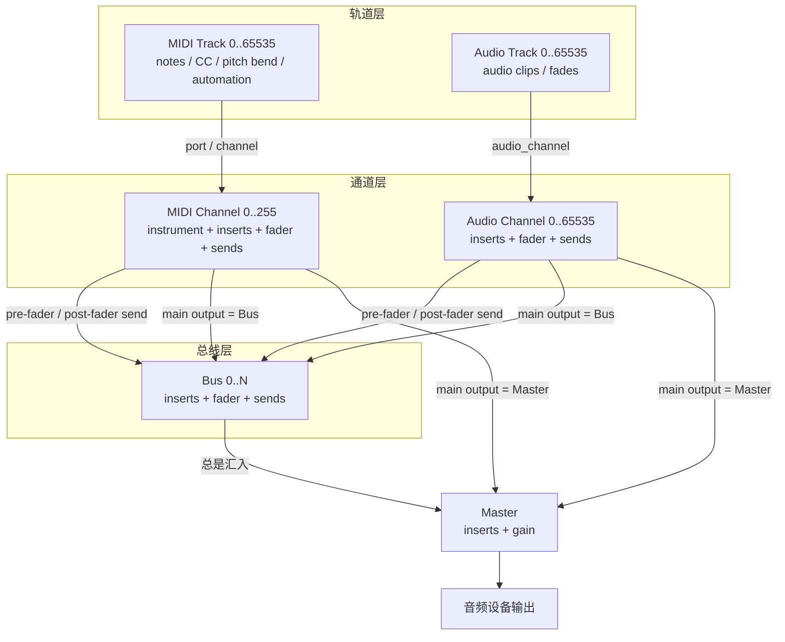
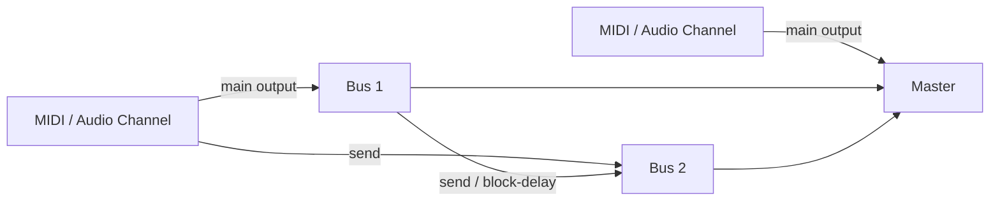
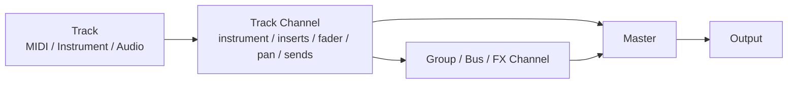
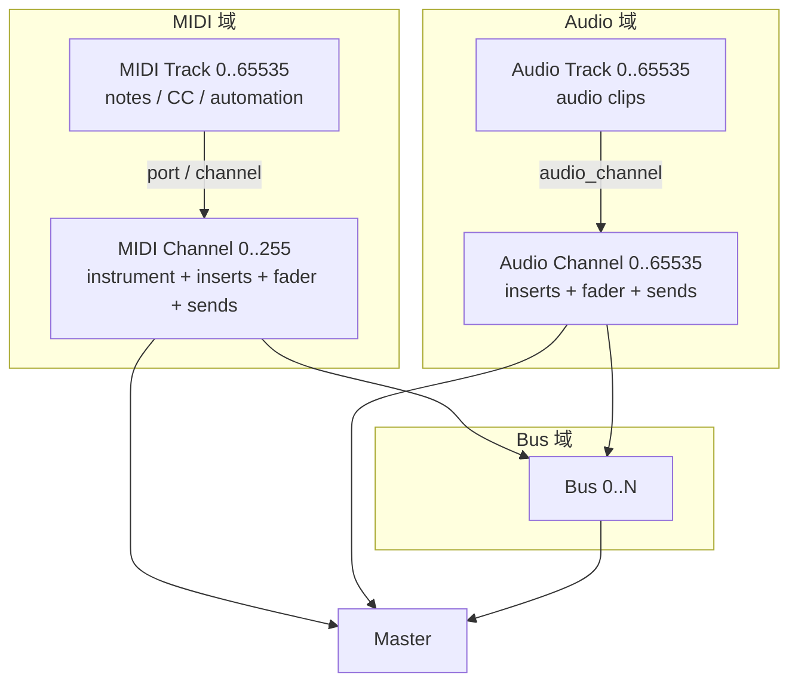

# 混音链路与通道模型

本文记录 yinhe 当前的混音信号流、通道数量上限、自动化归属，以及和成熟 DAW 的差异。
文中区分「当前实现」和「目标模型」，避免把设计意图和代码现状混在一起。

## 1. 术语

| 术语 | 含义 | 当前索引 |
|---|---|---|
| 轨道 Track | 内容容器：MIDI 音符 / 音频片段 / 自动化 | `u16`，0..65535 |
| MIDI 源通道 | MIDI 事件所属的端口 + 通道 | `port * 16 + channel`，0..255 |
| MIDI 混音通道 | MIDI 通道条：乐器 + insert + 推子 + 发送 | 0..255 |
| 音频通道 | 音频轨进入的混音条 | `u16`，0..65535 |
| Bus | 总线 / Return，可挂 insert、推子、发送 | `u16`，动态数量 |
| Master | 最终总输出，挂 master insert 和总增益 | 唯一 |

当前规则：MIDI 轨的混音通道恒等于它的端口/通道；音频轨的混音通道恒等于它的
`audio_channel`。轨道没有独立的混音通道路由字段。

## 2. 规模与索引

| 对象 | 上限 | 说明 |
|---|---:|---|
| 轨道 | 65536 | 音符里的 `track: u16`，GPU `MAX_TRACKS = 65536` |
| MIDI 源通道 | 256 | `u8`，`port << 4 \| channel` |
| MIDI 通道条 | 256 | `MixerParams.channels[0..256]` |
| 音频通道 | 65536 | `TrackData.audio_channel: Option<u16>` |
| Bus | 65536 | `u16`，实际数量由工程动态决定 |
| Master | 1 | 单独一条 |
| 默认乐器槽 | 16（当前限制） | `channel_instruments[16]`，只覆盖 Port A |
| XSynth 参数 | 256 | `synth_params[256]` |
| 混音台 MIDI strip | 256 | 与 MIDI 源通道一一对应 |

## 3. 当前链路

### 3.1 总链路



关键点：

- 一条 MIDI 通道条可以被多条 MIDI 轨共享。共享后，乐器、insert、推子、声像、
  发送、主输出都共享。
- 一条音频通道条可以被多条音频轨共享。当前音频轨通过 `audio_channel` 指向音频条。
- 通道可以同时有：
  - 多条发送，分别去不同 Bus；
  - 一个主输出，去 Master 或某条 Bus。
- Bus 之间可以互相发送；Bus 自身最终总是汇入 Master。
- Bus 自发送和逆序发送使用上一块输出快照，形成块级延迟，避免代数环。

### 3.2 MIDI 事件到声音


MIDI 轨只提供事件；声音由 MIDI 通道条上的乐器产生。多条轨共享同一 MIDI 通道时，
它们共享同一个乐器实例。

### 3.3 音频片段到声音


音频通道条没有乐器，只有 insert、推子、声像和发送。

### 3.4 Bus 与 Master



当前实现中：

- channel → Bus 的主输出是「后推子」信号。
- send 有推子前 / 推子后两种。
- Bus 之间可以串联或互发；跨 Bus 的逆序发送和自发送有一块延迟。
- Bus 的输出没有单独的「去哪个 Master」选择，所有 Bus 最终都汇入唯一 Master。

### 3.5 自动化归属

| 自动化目标 | 存储位置 | 归属 |
|---|---|---|
| Tempo | `ConductorData.tempo` | 全局 |
| CC / Pitch Bend / RPN / NRPN | 轨道 `automation_lanes` | 轨道所属 MIDI 通道 |
| 内置 XSynth / 通道 DSP 参数 | 轨道 `automation_lanes` | `ParamDevice::ChannelInstrument` |
| 插件乐器参数 | 轨道 `automation_lanes` | `ParamDevice::PluginInstrument` |
| 总线增益 | Master 轨的 `automation_lanes` | `AutomationTarget::BusGain { bus }` |
| Master 音量 | 目前没有独立自动化 lane | 只有手动增益 |

## 4. 当前实现中的口径问题

### 4.1 BusGain 为什么是例外

`AutomationLane` 目前必须挂在一条轨道上，而 Bus 不是轨道。为了把总线增益自动化
放进工程时间线，代码把 `BusGain` lane 放在 Master 轨上。

于是出现了几处特判：

- `TrackKind::Master` 的 `TrackContent::Automation` 是否允许，需要为 BusGain 单独放行；
- `Document::add_automation_lane` / `sanitize` 要单独保留 Master 上的 BusGain lane；
- 删除 Bus 时要把 Master 上的 lane target 前移；
- AR 固定 Bus 行需要把 Master 上的 lane 显示到对应 Bus 子行。

这不是 Bus 本身的语义，而是「自动化必须挂在轨道上」这个模型限制造成的。
更彻底的方案是给自动化增加 owner：

```text
AutomationOwner = Track(track_idx) | Bus(bus) | Master | Conductor
```

或者把 Bus 自动化独立存到 Mixer 参数层。这样 `TrackContent` 不需要为 BusGain
开例外，AR 也能按 owner 直接渲染。

### 4.2 AudioModel 为什么会回退到 MIDI Channel 0

`AudioModel::from_model` 里：

```rust
t.midi_target_channel()
    .unwrap_or_else(|| t.global_channel())
```

对音频轨、Folder、Master 轨，`midi_target_channel()` 返回 `None`，于是回退到
`global_channel()`。音频轨的 `port/channel` 默认是 0，所以最终变成 MIDI 通道 0。

影响：

- 音频轨的 `track_channel` 可能被当成 A01；
- `publish_track_levels` 可能把 A01 的混音电平当成音频轨电平；
- 音频轨上的 CC 类自动化如果存在，可能被广播到 A01；
- `track_banks` 的鼓声明也可能把音频轨的 CC0 lane 当成 A01 的 bank 声明。

正确的做法是不要回退：

```rust
pub track_channels: Vec<Option<u8>>; // 只有 MIDI 轨是 Some

let Some(channel) = track.midi_target_channel() else {
    continue; // 非 MIDI 轨不产生 MIDI 事件/电平
};
```

同时把音频轨电平单独走音频通道表，而不是复用 MIDI `track_channel`。

### 4.3 其他口径

| 项目 | 当前问题 |
|---|---|
| 默认乐器 | `channel_instruments[16]`，只覆盖 Port A；B..P 没有默认乐器 |
| 鼓通道覆盖 | `channel_percussion[16]`；B10 默认鼓但无法关闭 |
| 音频通道下降级 | `audio_target_channel()` 对 `None` 返回 `None`，`mixer_channel()` 却返回 `Audio(0)` |
| 音频通道 UI | 模型是 `u16`，轨道属性下拉只到 0..31 |
| 通道表示 | `MixerChannelId` / `InsertTarget` / `DockContext` / `CaChannel` / `ChannelNamespace` 五套 |
| 混音操作 | `SetStrip` / `SetAudioStrip` / `SetBusStrip` / `SetMaster` 四个入口 |
| M/S | 轨道 `track_overrides` 的 M/S 与通道条 `StripParams.mute/solo` 是两套状态 |
| 旧工程 | 已删除 `channel_routing`；旧工程里的该字段会被 serde 忽略，不再恢复 |
| 轨道电平表 | 非 MIDI 轨目前没有独立的 audio-track 电平路径 |

## 5. 成熟 DAW 的通用模型

大多数成熟 DAW 的核心不是「MIDI 通道条共享」，而是「每条轨道有自己的通道条」：



MIDI Channel 在这些 DAW 里通常只是事件路由（1..16），不是混音条的身份。
例如：

| DAW | 轨道与通道关系 | MIDI 通道的角色 |
|---|---|---|
| Studio One | 每条轨道有自己的 channel；Bus / FX channel 独立 | 乐器事件路由，不是混音条 |
| Cubase | MIDI / Instrument / Audio 轨 → Channel Strip → Group/FX → Stereo Out | MIDI 事件路由 |
| Ableton Live | 每条 Track 就是一个 channel；Group Track 做总线 | MIDI 通道是 clip/事件路由 |
| Bitwig | 每条 Track 是 channel；Group/FX/Return 做总线 | MIDI 通道是事件路由 |
| FL Studio | Channel Rack 乐器 → Mixer Track → Master | MIDI 通道是模式/事件路由 |
| REAPER | 每条 Track 是 channel；Folder 可充当 Bus | MIDI 通道是事件路由 |

共同点：

- 轨道级有独立的音量、声像、insert、send；
- Bus / Group 是汇总层；
- Master 是最终层；
- 侧链、VCA、Solo 模式、自动化都是围绕这个层级做的。

## 6. 目标模型

按「Master >（256 MIDI 通道 > 65536 MIDI 轨道）+ 65536 音频通道」的目标，
可以形式化为：



建议把它作为明确的产品约束：

1. **MIDI 轨是内容层，MIDI 通道是共享混音层。**
   多条 MIDI 轨可以共享一条 MIDI 通道；共享后音色、insert、推子、声像、发送都共享。
2. **音频轨是内容层，音频通道是共享混音层。**
   当前新建/自动分配保持 1 轨 : 1 音频通道；数据模型仍允许以后多条音频轨共享一条通道。
   以后要改的只是分配策略和 UI，不需要改数据模型。
3. **Bus 只做汇总，不承载轨道内容。**
4. **Master 唯一，只有总 insert 和总增益。**
5. **文件夹不是 Bus。** 文件夹只做组织，不参与混音。
6. **轨道不另设混音通道路由字段。**
   MIDI 轨的通道就是 `port/channel`，音频轨的通道就是 `audio_channel`。
7. **共享通道 / RACK 是核心卖点，不添加每轨独立推子。**
   需要独立混音时，用不同的 MIDI 通道（或以后用 VCA / 不同音频通道）解决，
   而不是给每条轨复制一条通道条。

这个模型和成熟 DAW 的差别不是对错，而是取舍：牺牲每条轨道的独立推子，换来 65536 轨
规模下不会创建 65536 条完整 channel strip。对黑乐谱这种轨道数量巨大、但混音结构
相对固定的工程，这个取舍是合理的。

## 7. 与成熟 DAW 的差距

| 能力 | 当前 | 成熟 DAW | 建议 |
|---|---|---|---|
| 每轨独立推子/声像 | 无，MIDI 轨共享通道 | 有 | **不添加**；共享通道是核心卖点，独立混音用不同 MIDI 通道 |
| 每轨独立 insert | 无，共享通道 | 有 | 保持通道级，避免 65536 条 insert 链 |
| 每轨独立乐器 | 无，共享 MIDI 通道乐器 | 有 | 保持通道级；需要独立音色时用不同 MIDI 通道 |
| Bus / Group | 有 | 有 | 保持 |
| VCA | 无 | Cubase/Studio One 有 | 可后加；控制通道组，不产生音频通路 |
| 侧链 | 无 | 多数有 | 可后加；先做内置压缩器侧链，再考虑插件 |
| 发送前/后 | 有 | 有 | 保持 |
| Bus 自动化 | BusGain（挂在 Master） | 原生 Bus 自动化 | 改成 `AutomationOwner::Bus` + 稳定 BusId |
| 音频通道音量自动化 | 无 | 有 | 增加 `MixerGain { Audio(ch) }` lane |
| Master 音量自动化 | 无 | 有 | 增加 `MixerGain { Master }` lane |
| Track M/S | `track_overrides` | 有 | 保留内容级 M/S |
| 通道 M/S | `StripParams` | 有 | 保留混音级 M/S；与 Track M/S 分层，不合并存储 |
| 延迟补偿 | 有 | 有 | 保持 |
| 轨道冻结 | 无 | 多数有 | P1；按共享通道模型优先做「通道冻结」 |
| 多硬件输出 | 无 | 有 | 需要时再加 |
| 环绕声 | 无 | 部分有 | 暂不考虑 |

## 8. 关键概念与实现建议

### 8.1 VCA 是什么

VCA（Voltage Controlled Amplifier）是「控制电压放大器」的缩写。在 DAW 里它不是
音频总线，而是一个**控制组**：

- 不接收音频输入；
- 不做音频求和；
- 不挂 insert；
- 只提供一个增益，按成员列表去乘多个通道/Bus 的推子。

```text
VCA "Drums" gain = -6 dB
├─ MIDI Channel A10
├─ MIDI Channel B10
└─ Bus 3
```

效果类似「同时拖动这几个通道的推子」，但不会改变它们的路由、发送和 insert。

它适合当前模型，因为：

- 不增加每轨推子；
- 一个 VCA 可以控制多条 MIDI 通道 / Bus；
- 与共享通道 / RACK 的卖点不冲突。

以后如果要做，模型可以是：

```rust
struct VcaGroup {
    id: VcaId,
    name: String,
    gain: f32,
    members: Vec<MixerChannelId>,
}
```

混音图在计算成员通道时先乘 VCA gain，再走原来的推子 / 发送 / 主输出。

### 8.2 Bus 侧链是什么

侧链（sidechain）是「用 A 的信号去控制 B 上的处理器」，A 不直接进入 B 的音频
通路。典型用法：

- 底鼓触发贝斯 Bus 上的压缩器；
- 人声触发音乐 Bus 上的压缩器；
- 一个 Bus 触发另一个 Bus 上的 Gate。

它和 Send 的区别：

- Send 是把音频送到目标 Bus 参与求和；
- Sidechain 只把音频作为检测信号，不参与求和。

当前 insert 处理器只有主输入，没有侧链输入，所以要做侧链需要：

1. 在 `MixerGraph` 里为每个 insert 增加一个 sidechain 缓冲；
2. 在 `MixerParams` 里增加 `SidechainSource { channel: MixerChannelId }`；
3. 先支持内置压缩器 / Gate，再考虑 VST3/CLAP 的 sidechain 端口。

这是 P2 功能，不影响当前链路正确性。

### 8.3 Bus 自动化如何做成原生

当前实现的问题不是「Bus 不能自动化」，而是 Bus 没有自己的自动化宿主，只能把
`BusGain` lane 塞进 Master 轨。

原生做法建议分两步：

1. **稳定 BusId**
   当前 Bus 用 `Vec` 下标标识，删除 Bus 时后续索引前移，所有 lane target 都要
   手工重映射。应给 Bus 增加稳定 ID：

   ```rust
   struct Bus {
       id: BusId,          // 稳定，不随删除/重排变化
       strip: StripParams,
       inserts: Vec<InsertRef>,
       sends: Vec<SendParams>,
   }
   ```

   `MixerChannelId::Bus(BusId)` 和 `AutomationTarget` 都用这个 ID。

2. **自动化 owner**
   把自动化从「必须挂在轨道」改成「按 owner 存储」：

   ```text
   AutomationOwner = Track(track) | MixerChannel(MixerChannelId) | Conductor
   ```

   Bus 的 lane 直接属于 `MixerChannel(Bus(id))`，不再借住 Master。AR 的固定 Bus
   行直接读对应 owner 的 lane。

这样 `TrackContent` 不需要为 BusGain 开特例，删除 Bus 时也不会出现「模型删了，
Master 上的 lane 还没删」的错位。

### 8.4 音频通道与 Master 的音量自动化

建议统一成一个通用的混音参数目标，而不是继续给每种通道加一个专用变体：

```rust
enum AutomationTarget {
    // 现有 MIDI 原生目标
    CC { controller: u8 },
    PitchBend,
    Rpn { parameter: u16 },
    Nrpn { parameter: u16 },

    // 混音台参数
    MixerGain { channel: MixerChannelId },
    MixerPan { channel: MixerChannelId },

    // 全局
    Tempo,
}
```

其中：

- `MixerGain { Midi(ch) }` = MIDI 通道推子自动化；
- `MixerGain { Audio(ch) }` = 音频通道推子自动化；
- `MixerGain { Bus(id) }` = Bus 推子自动化；
- `MixerGain { Master }` = Master 推子自动化；
- `MixerPan { .. }` 同理。

要区分两种「音量」：

| 目标 | 作用点 | 用途 |
|---|---|---|
| `CC { controller: 7 }` | MIDI 事件进入乐器之前 | MIDI 音量、乐器表情 |
| `MixerGain` | 通道条 insert 之后、推子处 | 混音推子自动化 |

现在右键音量旋钮添加的是 CC7 / BusGain，这个口径应该逐步改成：
MIDI 通道推子自动化走 `MixerGain`，CC7 作为显式的 MIDI CC 目标保留。

自动化求值可以直接复用 BusGain 的 tick 求值路径：每个块开始时根据当前 tick
把 lane 值写到对应通道的 `StripParams.gain` / `.pan`。手动推子和自动化的关系
需要明确为「有 lane 时以 lane 为准」或后续再实现 Read/Write/Latch 模式。

### 8.5 Track M/S 与 Channel M/S 如何统一

不建议把两者合并成一份状态，因为它们回答的是两个不同问题：

| 层 | 位置 | 作用 |
|---|---|---|
| Track M/S | AR 轨道面板 | 控制该轨的内容是否送入通道；不影响同通道其他轨 |
| Channel M/S | MIX 通道条 / 通道 AR 通道行 | 控制整条通道输出；影响共享该通道的所有轨 |

建议保留两层，但把语义写死：

```text
轨道可听 = 轨道 mute/solo 通过
通道可听 = 通道 strip mute/solo 通过
最终可听 = 轨道可听 && 通道可听
```

Solo 语义：

1. 有轨道 solo 时，只允许 soloed 轨道通过；
2. 有通道 solo 时，只允许 soloed 通道通过；
3. 两者同时存在时，取交集；
4. 没有 solo 时，mute 正常生效。

UI 上必须区分名字和提示：

- AR 轨道面板：轨道静音 / 轨道独奏；
- MIX strip 和通道 AR 通道行：通道静音 / 通道独奏。

这样既保留「多轨共享通道」下单独屏蔽某条轨的能力，也保留整条通道静音的能力。
不需要把 `TrackOverride` 和 `StripParams` 合成一个结构，只需要统一「最终可听」
的计算入口，避免两套 solo 逻辑各算各的。

### 8.6 轨道冻结怎么设计

因为共享通道/RACK 是核心，**冻结的基本单位应该是 MIDI 通道，而不是单条轨道**。

原因：

- 同一 MIDI 通道上的多条轨共享乐器、insert、推子；
- 单独冻结一条轨，无法在不复制乐器/insert 的情况下得到与实时播放完全一致的结果；
- 如果给每条轨复制乐器，就违背了共享 RACK 的设计。

推荐第一版：

```text
冻结 MIDI 通道：
  离线渲染 该通道所有轨道的乐器输出
  得到一条 frozen audio
  播放时跳过该通道的 MIDI 分发，直接播放 frozen audio
  通道 insert / 推子 / 声像 / 发送 仍然实时生效
```

这样：

- 冻结后仍可调通道推子、insert、发送；
- 修改该通道任何轨道的音符、乐器、通道 insert 时，冻结自动失效；
- 撤销/重做需要记录冻结状态和源 revision；
- 工程需要保存 frozen audio 资产，或保存到工程缓存目录。

UI 上可以仍然让用户在轨道上点「冻结」，但提示/状态显示为「冻结通道 A01」，
并明确同通道其他轨也会一起冻结。

如果以后确实需要「单轨冻结」，前提是给该轨独立的乐器/通道，这与共享通道模型
是互斥的，需要先做产品决策。

## 9. 推荐的清理顺序

### P0：先消灭行为不一致

1. `channel_instruments` / `channel_percussion` 扩到 256，或明确限制 16 并隐藏 B..P。
   推荐扩到 256。
2. `AudioModel.track_channels` 改为 `Vec<Option<u8>>`，非 MIDI 轨直接跳过。
3. `audio_target_channel()` 统一回退 `audio_channel.unwrap_or(0)`。
4. 收敛 `MixerChannelId` / `InsertTarget` / `DockContext` / `CaChannel`。
5. BusGain 改成 `AutomationOwner::Bus`，或者至少在能力模型里显式声明 Master 允许 BusGain。

### P1：补齐核心能力

1. **通道冻结**（按共享通道模型，先做 MIDI 通道冻结）。
2. `MixerGain` / `MixerPan` 自动化，覆盖 MIDI / 音频 / Bus / Master。
3. Bus 自动化 owner + 稳定 BusId。
4. **M/S 语义统一**：保留 Track M/S 与 Channel M/S 两层，但共用最终可听计算。
5. VCA 控制组。

### P2：大工程能力

1. Bus 侧链（先内置压缩器）。
2. 多硬件输出。
3. 乐器多输出。
4. 更完整的 Solo 模式（Solo-safe、Solo by Bus）。

## 10. 相关代码

- `crates/yinhe-core/src/model.rs`：`TrackData`、`mixer_channel`、`channel_instruments`
- `crates/yinhe-mixer/src/params.rs`：`MixerParams`、Bus、发送、主输出
- `crates/yinhe-mixer/src/graph.rs`：通道 / Bus / Master 的实际 DSP 链路
- `crates/yinhe-audio/src/channel_layout.rs`：MIDI / 音频通道的 dense 映射
- `crates/yinhe-audio/src/engine_mixer.rs`：持久化参数 ↔ 混音图接线
- `crates/yinhe-audio/src/audio_model.rs`：MIDI 事件、鼓声明、音频模型
- `crates/yinhe-egui/src/channel_arrange/`：MIX 通道 AR 与通道分组
- `crates/yinhe-egui/src/mix.rs`：混音台 UI 与 `MixAction`
- `crates/yinhe-egui/src/right_panel/info_panel/channel.rs`：通道属性面板
